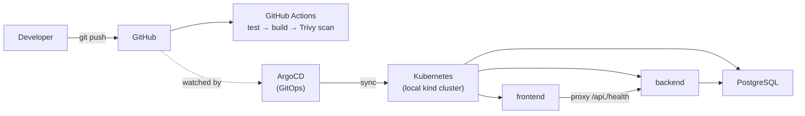
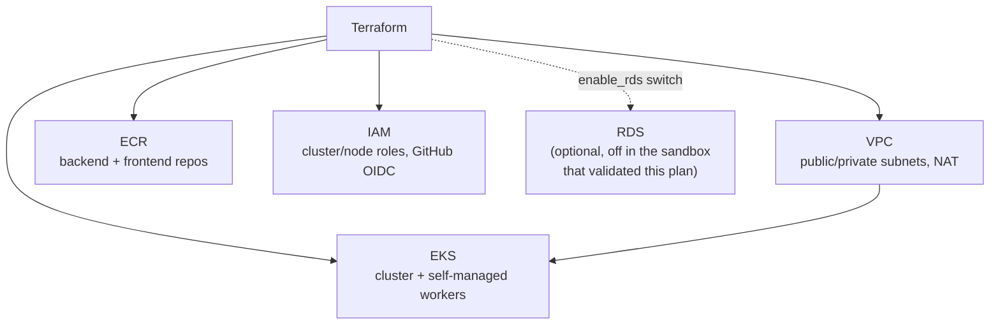

# CloudForge

> Production-style DevOps/platform engineering portfolio project. See
> [docs/phases.md](docs/phases.md) for the full phase-by-phase build log,
> [docs/evidence/](docs/evidence/) for command-output evidence backing
> every claim below, and [docs/screenshots/](docs/screenshots/) for the
> visual checklist.

## Overview

CloudForge demonstrates the infrastructure and operational lifecycle of a
containerized application: containerization, Kubernetes, Infrastructure as
Code, CI/CD, GitOps, observability, and security testing. **The application
itself is deliberately simple** — it exists only to give the platform
something real to build, deploy, and operate.

## Application

- **Frontend** — static HTML/CSS/JS, no build tooling, served by nginx.
- **Backend** — FastAPI, with `/health` (pure liveness) and `/api/status`
  (backend + database connectivity) endpoints.
- **PostgreSQL** — the backend's only stateful dependency.

That's it. No auth, no microservices, no message queues — this project is
about the platform around the app, not the app itself.

## Architecture

**Deployment flow (implemented and runtime-verified):**



**Terraform AWS target architecture (designed, security-scanned, and
successfully planned — see the "AWS / Terraform" section below for exactly
what that means and doesn't mean):**



### What's implemented and runtime-verified vs. what's designed-only

| | Status |
|---|---|
| Docker (multi-stage builds, health checks, non-root) | ✅ Runtime-verified |
| Local Kubernetes (kind) | ✅ Runtime-verified |
| GitHub Actions CI (test, build, Trivy gate) | ✅ Runtime-verified |
| ArgoCD GitOps (sync, rollback) | ✅ Runtime-verified |
| Prometheus + Grafana | ✅ Runtime-verified |
| Loki (logs) | ✅ Runtime-verified |
| Failure/reliability testing | ✅ Runtime-verified |
| Terraform code, `tfsec`, `terraform plan` | ✅ Validated against a real (ephemeral) AWS account |
| EKS cluster / ECR repos / RDS actually provisioned on AWS | ❌ Not done — `terraform apply` was never run |

**On the AWS infrastructure, precisely:**

> The AWS infrastructure was designed, security-scanned, validated, and
> successfully planned with Terraform against an ephemeral AWS sandbox. The
> Kubernetes application runtime was fully deployed and operationally
> validated on a local kind cluster.

AWS EKS was not deployed, the application did not run on EKS, no images
were pushed to ECR, and no AWS infrastructure was provisioned — see
[docs/evidence/05-terraform-plan-summary.txt](docs/evidence/05-terraform-plan-summary.txt)
for exactly what was planned and why `apply` was deliberately not run.

## Repository Structure

```
cloudforge-platform/
├── app/
│   ├── frontend/         # Static HTML/CSS/JS
│   └── backend/          # FastAPI service
├── terraform/
│   ├── bootstrap/        # One-time: S3 remote-state bucket (not applied)
│   ├── modules/          # vpc, eks, ecr, rds, github-oidc
│   └── environments/dev  # Composes all modules
├── kubernetes/
│   ├── base/              # Deployments, Services, ConfigMap, HPA, Ingress, PVC
│   └── overlays/dev/      # Namespace + environment composition
├── argocd/                 # ArgoCD Application definition
├── monitoring/               # Prometheus/Grafana/Loki Helm values + install script
├── .github/workflows/         # CI pipeline
├── docs/
│   ├── phases.md               # Full phase-by-phase build log
│   ├── evidence/                # Command-output evidence, one file per area
│   └── screenshots/              # Visual checklist (see status column)
└── scripts/                       # Cluster/secret setup scripts
```

## Docker

- **Multi-stage backend build**: a `builder` stage installs Python
  dependencies to `--user` site-packages; the final stage copies only that
  + app code into a slim runtime image — no pip, build tools, or caches.
- **Non-root by design**: backend runs as `appuser` (uid 10001), frontend
  runs on `nginxinc/nginx-unprivileged` (uid 101) — verified live via
  `kubectl exec ... id -u` (see
  [docs/evidence/09-security-validation.txt](docs/evidence/09-security-validation.txt)).
- **Real health checks**: Docker `HEALTHCHECK` on every container, backing
  the same `/health` endpoints Kubernetes probes later use.
- **`docker-compose`** for local dev — full three-service stack with
  `depends_on: condition: service_healthy` so the backend doesn't start
  under the assumption Postgres is ready until `pg_isready` actually
  passes.

## Kubernetes

- **Deployments** for frontend, backend, postgres — with explicit
  `resources.requests`/`limits` on every container.
- **Services** (ClusterIP) for internal routing; an **Ingress**
  (ingress-nginx) at the edge routing everything to the frontend, whose own
  nginx config reverse-proxies `/api/*` and `/health` to the backend — no
  CORS needed anywhere.
- **ConfigMap** for non-secret backend config; **Secret**
  (`postgres-credentials`) provisioned out-of-band
  (`scripts/create-postgres-secret.sh`), never generated inside a
  Git-tracked Kustomize `secretGenerator` — that pattern broke ArgoCD's
  `kustomize build` against the committed repo (see Phase 7 notes in
  [docs/phases.md](docs/phases.md)).
- **Readiness AND liveness probes both target `/health`**, deliberately —
  if readiness checked DB connectivity, a single Postgres blip would pull
  every backend pod out of the Service simultaneously, turning a dependency
  hiccup into a total outage. Verified this specific failure mode directly
  in Phase 9 (see Reliability Testing below).
- **HPA** on the backend (min 2 / max 4, 70% CPU target).

## CI/CD

GitHub Actions, on every push/PR to `main`:

```
push / PR → test (pytest) → build (matrix: backend, frontend) → Trivy scan gate
```

- **Trivy gate policy, derived from actually scanning the images, not
  guessed**: fails only on `CRITICAL` vulnerabilities with a fix available
  (`--ignore-unfixed`); a separate non-blocking scan reports everything to
  GitHub's Security tab for visibility. Two real vulnerabilities were found
  and fixed this way during development — a `starlette` DoS CVE (fixed via
  a `fastapi` version bump) and two CRITICAL OpenSSL CVEs in the frontend's
  Alpine base (fixed with `apk upgrade` at build time).
- **ECR publish step exists in the workflow but has never actually run
  successfully** — it's gated behind a `vars.AWS_ROLE_ARN` repo variable
  that was never set, since the OIDC IAM role it needs was never applied to
  AWS (see the AWS/Terraform section). No images have been pushed to ECR.
- Verified live: see
  [docs/evidence/03-github-actions-validation.txt](docs/evidence/03-github-actions-validation.txt)
  for the actual run history — every run on `main` is green.

## GitOps

ArgoCD watches this repo's `kubernetes/overlays/dev` and reconciles the
live cluster to match it:

- `syncPolicy.automated` with `prune: true` and `selfHeal: true` — a manual
  `kubectl edit` that drifts from Git gets reverted automatically, and a
  resource removed from Git gets deleted from the cluster.
- **Real bad-deployment + revert test, not simulated**: committed a backend
  image with a nonexistent tag, pushed, watched ArgoCD sync it and the new
  pod fail with `ImagePullBackOff` (exact error captured — see
  [docs/evidence/08-failure-recovery.txt](docs/evidence/08-failure-recovery.txt))
  while the **old pods stayed running the entire time** — Kubernetes' rolling
  update strategy prevented any outage. Rolled back with `git revert` +
  push (the GitOps-correct way — a raw `kubectl rollout undo` would have
  been immediately fought by `selfHeal`), watched ArgoCD sync the revert,
  and confirmed recovery onto the *original* ReplicaSet with
  `Synced` / `Healthy` and `database: connected`.
- **A real GitOps mechanics finding**: mid-way through reliability testing
  (Phase 9), a manual `kubectl scale postgres --replicas=0` chaos test was
  *immediately undone by ArgoCD's own selfHeal* — exactly the automation
  working as designed, but it meant chaos-testing needed
  `syncPolicy.automated` temporarily disabled first. Documented as the
  correct practice for chaos-testing a GitOps-managed cluster.

## Observability

- **Prometheus** (`kube-prometheus-stack` via Helm): scrapes `kubelet`
  (per-pod CPU/memory via cAdvisor), `kube-state-metrics` (deployment/pod
  health), and `node-exporter` (node OS metrics) — 16 active targets, with
  live queries verified against `cloudforge-dev`'s actual pods (see
  [docs/evidence/07-observability-validation.txt](docs/evidence/07-observability-validation.txt)).
- **Grafana**: 28 real shipped dashboards (not built from scratch — genuine
  community dashboards querying real Prometheus data), confirmed via
  Grafana's own API that it can proxy queries through to Prometheus
  successfully.
- **Loki** (`loki-stack` via Helm, with Promtail shipping logs): verified
  by querying real backend log lines directly out of Loki. Found and fixed
  a real bug along the way — the chart's auto-generated Grafana datasource
  set `isDefault: true`, conflicting with Prometheus's own default and
  breaking Grafana's provisioning entirely; fixed and captured in
  `monitoring/install.sh` so it's reproducible, not a one-off patch.

## Security

- **Trivy**: container image scanning, gated in CI (see CI/CD above) and
  re-verified against final images in Phase 9 — 0 findings.
- **tfsec**: static Terraform security scanning — 0 CRITICAL, 0 HIGH, 1
  documented ignore (an accepted-risk EKS public-endpoint finding,
  mitigated by restricting `public_access_cidrs` to the caller's own IP
  rather than `0.0.0.0/0`; see `terraform/modules/eks/main.tf`).
- **Git credential scanning**: `git grep -n -E
  'AKIA|ASIA|aws_secret_access_key|aws_session_token'` across the working
  tree and full history — clean (the one match found is a false positive:
  a line in `docs/phases.md` quoting this very command as documentation,
  not a real credential; see
  [docs/evidence/09-security-validation.txt](docs/evidence/09-security-validation.txt)
  for the full analysis).
- **IAM least privilege**: the GitHub Actions OIDC role's trust policy is
  restricted to `repo:AkhilTejaDoosari/cloudforge-platform:ref:refs/heads/main`
  specifically (a PR from a fork can't assume it), and its IAM policy is
  scoped to exactly this project's two ECR repo ARNs, not `ecr:*` on `*`.
- **Non-root containers**: backend (uid 10001) and frontend (uid 101) are
  non-root by design.

**Known gap, documented honestly, not hidden**: the local PostgreSQL
container runs as **UID 0 (root)** — this is the official
`postgres:16-alpine` image's default behavior, never hardened in this
project. The AWS production architecture (`terraform/modules/rds`) is
designed to replace this local container entirely with managed RDS, whose
OS layer isn't something a Terraform user hardens directly — but since that
module was never applied, this gap is real and present in the currently
running local cluster.

## Reliability Testing

All 6 tests actually executed against the live cluster in Phase 9, with
real evidence in
[docs/evidence/08-failure-recovery.txt](docs/evidence/08-failure-recovery.txt):

1. **Backend pod deletion** → Kubernetes recreated it, Ready in 7s.
2. **Frontend pod deletion** → recreated, Ready in 6s.
3. **PostgreSQL interruption** → `/health` stayed `ok`, `/api/status`
   correctly reported `disconnected`, backend pods never crashed, self-healed
   to `connected` with zero backend restarts once Postgres came back.
4. **Readiness probe verification** — confirmed live config, and implicitly
   exercised by tests 1-2 (`kubectl wait --for=condition=ready` only
   succeeds once the probe passes).
5. **Liveness probe verification — an actual triggered restart, not just
   config inspection.** `SIGSTOP`/`SIGKILL` sent directly to the
   container's PID 1 had no effect (Linux protects PID 1 in a container's
   namespace from unhandled signals) — pivoted to patching the liveness
   probe path to a nonexistent endpoint and captured the real kubelet
   events: `Liveness probe failed: HTTP probe failed with statuscode: 404`
   → `Killing: Container backend failed liveness probe, will be restarted`.
6. **Deliberately failed deployment → Git revert → ArgoCD reconciliation →
   recovery onto the original ReplicaSet** — see GitOps section above.

## AWS / Terraform

Five modules (`vpc`, `eks`, `ecr`, `rds`, `github-oidc`), composed by
`terraform/environments/dev`, each with its own `variables.tf`/`outputs.tf`/`versions.tf`.

- **VPC**: public/private subnets across 2 AZs, single NAT Gateway (a
  documented cost/availability tradeoff — ~$32/mo vs. ~$96/mo for 3, right
  call for a dev/demo environment).
- **EKS**: cluster + **self-managed** worker nodes (launch template + Auto
  Scaling Group), not a managed node group. This is a deliberate adaptation
  to the ephemeral AWS sandbox this plan was validated against — confirmed
  via `aws iam simulate-principal-policy` (a read-only permission check,
  no resources created) that account's IAM policy grants `eks:CreateCluster`
  but not `eks:CreateNodegroup` or `eks:CreateFargateProfile`, while
  `ec2:RunInstances` and `autoscaling:CreateAutoScalingGroup` are both
  allowed. Worker cluster auth uses an EKS access entry
  (`type = EC2_LINUX`), not the legacy `aws-auth` ConfigMap.
- **ECR**: two repositories (`cloudforge/backend`, `cloudforge/frontend`),
  matching the CI workflow's naming exactly.
- **RDS**: gated behind a clean `enable_rds` variable (default `true`) —
  disabled only via a gitignored `terraform.tfvars` for the sandbox that
  doesn't permit `rds:CreateDBInstance`, never via `-target` and never by
  deleting the module.
- **`github-oidc`**: the IAM role GitHub Actions would assume to push to
  ECR — trust policy restricted to this repo and the `main` branch
  specifically.

**Validated, not applied**: `terraform fmt`, `terraform init -backend=false`,
`terraform validate`, `tfsec` (0 CRITICAL, 0 HIGH), and `terraform plan`
(35 to add, 0 to destroy) all ran clean against a real, ephemeral KodeKloud
AWS sandbox account. `terraform apply` was deliberately never run — the
sandbox's STS session tokens expired twice during the work, and the
decision was made to stop AWS provisioning for that session rather than
keep fighting credential lifecycle friction. Full detail, including the
exact IAM findings and every bug found along the way, in
[docs/phases.md](docs/phases.md)'s Phase 5/6 notes.

## Evidence

Real command output backing every claim in this README, one file per area:

| File | Covers |
|---|---|
| [01-docker-validation.txt](docs/evidence/01-docker-validation.txt) | Multi-stage builds, image sizes, non-root defaults, docker-compose end-to-end |
| [02-kubernetes-validation.txt](docs/evidence/02-kubernetes-validation.txt) | Live cluster state, Services, Ingress, HPA, probe config |
| [03-github-actions-validation.txt](docs/evidence/03-github-actions-validation.txt) | CI run history, latest run detail |
| [04-terraform-validation.txt](docs/evidence/04-terraform-validation.txt) | `fmt`/`init`/`validate`/`tfsec` output |
| [05-terraform-plan-summary.txt](docs/evidence/05-terraform-plan-summary.txt) | Full plan breakdown, exactly what was and wasn't planned, and why |
| [06-argocd-validation.txt](docs/evidence/06-argocd-validation.txt) | Application sync/health status, managed resources |
| [07-observability-validation.txt](docs/evidence/07-observability-validation.txt) | Live Prometheus/Loki/Grafana queries against real data |
| [08-failure-recovery.txt](docs/evidence/08-failure-recovery.txt) | All 6 Phase 9 reliability tests, in detail |
| [09-security-validation.txt](docs/evidence/09-security-validation.txt) | Trivy, tfsec, non-root verification, credential scan |
| [10-project-final-state.txt](docs/evidence/10-project-final-state.txt) | Final snapshot: git log, full cluster state, ArgoCD status, live app verification |

## Screenshots

See [docs/screenshots/README.md](docs/screenshots/README.md) for the full
checklist with capture instructions. **None have been captured yet** — all
8 are marked `PENDING MANUAL CAPTURE`.

## Lessons Learned

- **A process being "running" isn't the same as it being healthy.**
  `SIGSTOP`/`SIGKILL` to a container's PID 1 had no effect at all — Linux
  specially protects PID 1 in a container's namespace from unhandled
  signals. The *only* reliable way to test a liveness probe is to break
  what it actually checks, not to assume a killed process proves anything.
- **GitOps automation fights manual intervention by design — that's a
  feature, but it means chaos-testing needs a different playbook.**
  `selfHeal` reverted a manual `kubectl scale` within seconds. Pause
  automation deliberately before chaos-testing a GitOps-managed cluster;
  don't fight it, and don't mistake the fight for a bug.
- **`terraform validate` and `terraform plan` catch genuinely different
  classes of bugs.** A `for_each` over a set of apply-time-unknown values
  passed `validate` cleanly and only failed at `plan` — validate doesn't
  trace whether a resource's inputs are actually knowable yet.
- **A cloud sandbox's IAM policy is data, not a guess** — `aws iam
  simulate-principal-policy` (read-only, creates nothing) turned "EKS
  probably won't work here" into an exact, evidenced list of which actions
  are and aren't granted, which turned into a specific, minimal
  architecture change (self-managed nodes, one hard-coded IAM role name)
  instead of a guess-and-check cycle against real `apply` failures.
- **Managed vs. self-managed EKS workers is a real, defensible tradeoff,**
  not just "the sandbox forced it" — self-managed nodes mean owning AMI
  selection, bootstrap (AL2023's `nodeadm`, not the older
  `/etc/eks/bootstrap.sh`), and cluster-auth wiring (an `EKS access entry`,
  since managed node groups get one automatically and self-managed ones
  don't) — more moving parts, but exactly what a sandbox with a narrower
  IAM surface actually permits.
- **Credential lifecycle friction is itself a real operational lesson.**
  STS tokens expiring mid-session, twice, is exactly the kind of thing that
  happens in short-lived training/sandbox environments — the right call was
  stopping AWS work and shipping the Kubernetes-runtime deliverable
  cleanly, not fighting the sandbox indefinitely.
- **Verify operationally, don't assume success.** Nearly every phase in
  this project surfaced a real bug that a purely "looks correct" review
  would have missed — a missing `v` prefix on a pinned GitHub Action tag,
  a Kustomize `secretGenerator` that broke ArgoCD's `kustomize build`, a
  Helm chart's default `isDefault: true` silently breaking Grafana's
  provisioning. Every one of them was caught by actually running the thing
  and reading the real error, not by re-reading the code more carefully.

## Local Reproduction

**Docker Compose:**
```bash
cp .env.example .env
docker compose up -d --build
curl http://localhost:3000/api/status
```

**Kubernetes (kind):**
```bash
brew install kind
./scripts/k8s-dev-up.sh
curl -H "Host: cloudforge.local" http://localhost/api/status
```

**ArgoCD:**
```bash
kubectl create namespace argocd
kubectl apply -n argocd -f https://raw.githubusercontent.com/argoproj/argo-cd/v2.13.2/manifests/install.yaml
kubectl apply -f argocd/application.yaml
kubectl get application cloudforge -n argocd
```
(Requires repo access configured as a Secret — see `docs/phases.md`'s Phase
7 notes. No credentials are included anywhere in this repo.)

**Monitoring:**
```bash
./monitoring/install.sh
kubectl port-forward -n monitoring svc/kube-prometheus-stack-grafana 3000:80
# open http://localhost:3000, user: admin
kubectl get secret kube-prometheus-stack-grafana -n monitoring \
  -o jsonpath='{.data.admin-password}' | base64 -d; echo
```

## Cleanup

**Local kind cluster (everything — app, ArgoCD, monitoring):**
```bash
./scripts/k8s-dev-down.sh
```

**Terraform-managed AWS infrastructure** (not currently provisioned — see
AWS/Terraform above — but the exact command for when it is):
```bash
cd terraform/environments/dev
terraform destroy
```
The `terraform/bootstrap` state bucket (if ever created) has
`prevent_destroy` on it deliberately — remove that lifecycle block (or
`terraform state rm`) before it will allow destroy, and only after every
environment using it as a backend has been destroyed first.
