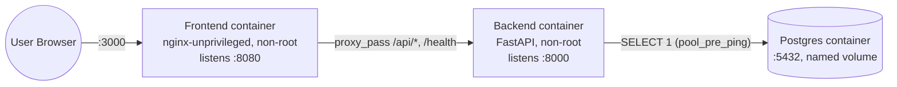
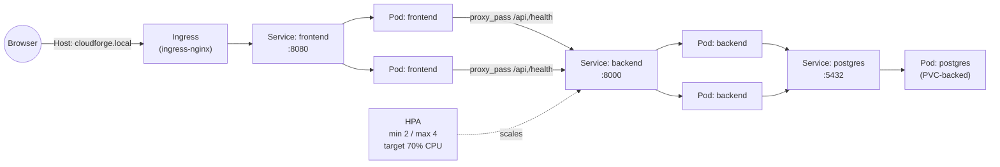
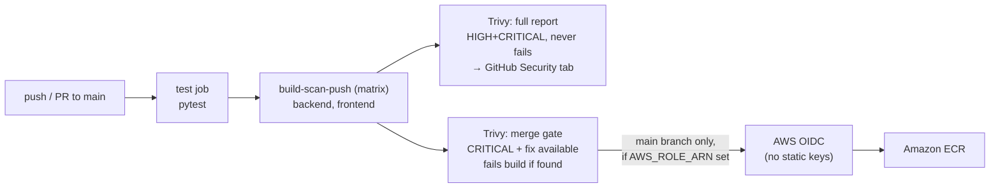
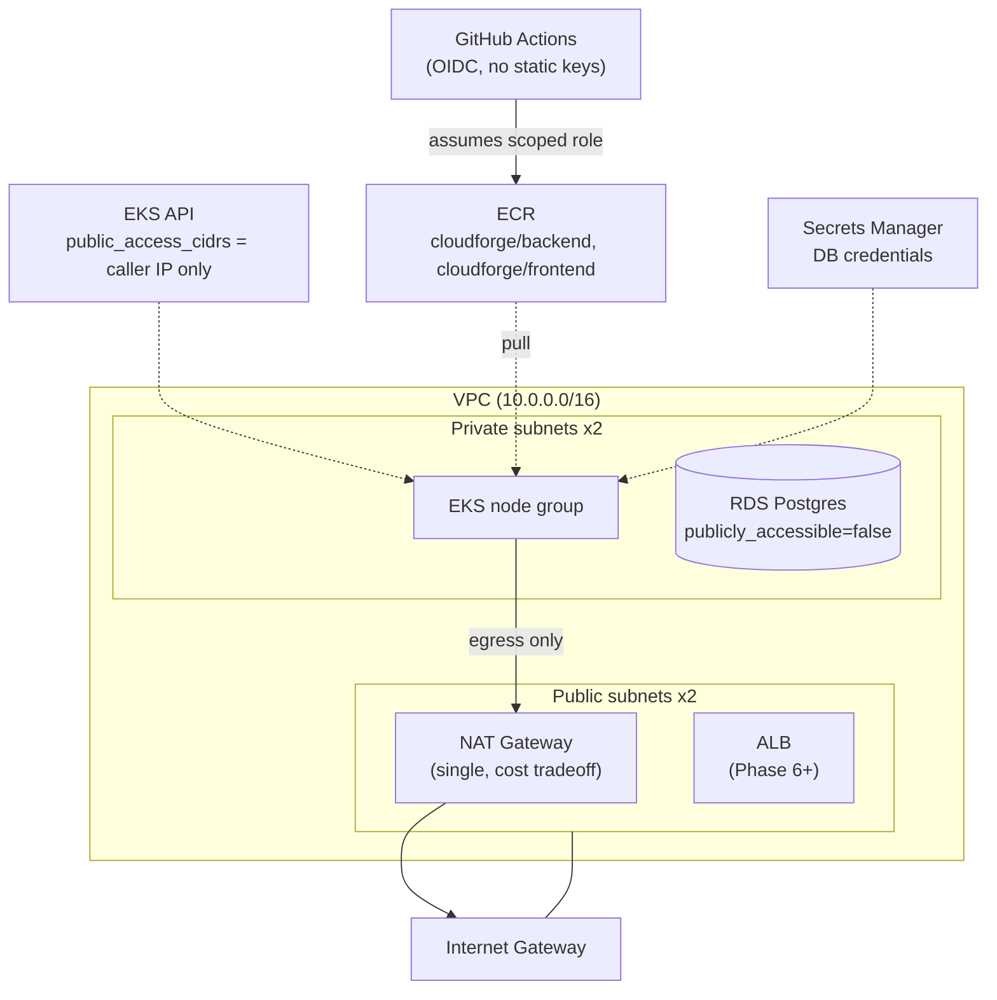

# CloudForge — Production Kubernetes Platform on AWS

> **Status: Phase 5 of 10 complete.** This README grows with each phase; sections
> for Terraform, Kubernetes, CI/CD, GitOps, observability, and security will be
> filled in as those phases land. See [docs/phases.md](docs/phases.md) for the
> full roadmap and phase-by-phase log.

## Project Overview

CloudForge is a portfolio project demonstrating a production-grade DevOps/platform
engineering workflow: containerization, Kubernetes, Infrastructure as Code, CI/CD,
GitOps, observability, and security — all wrapped around a deliberately simple
application. **The application is not the point.** It exists only to give the
platform something real to build, deploy, and operate.

## Technology Stack

| Layer | Technology | Why |
|---|---|---|
| Backend | FastAPI (Python) | Async, minimal, built-in OpenAPI docs, industry-standard for lightweight services |
| Frontend | Static HTML/CSS/JS | No build tooling — keeps focus on infra, not frontend frameworks |
| Database | PostgreSQL | Real stateful dependency to justify RDS, Secrets, and connection management |
| Containers | Docker (multi-stage) | Reproducible builds, small images |
| Orchestration | Kubernetes (EKS) | Industry-standard container orchestration |
| IaC | Terraform | Modular, versioned, reviewable infrastructure |
| CI | GitHub Actions | Test → build → scan (Trivy) → publish to ECR (OIDC, no static AWS keys) |
| CD | ArgoCD (GitOps) | Declarative, auditable, git-as-source-of-truth deployments |
| Observability | Prometheus, Grafana, Loki | Metrics + dashboards + logs |
| Cloud | AWS (VPC, EKS, ECR, RDS, IAM, ALB, CloudWatch) | Real-world production target |

## Repository Structure

```
cloudforge-platform/
├── app/
│   ├── frontend/        # Static HTML/CSS/JS, calls backend /api/status
│   └── backend/         # FastAPI service, /health and /api/status endpoints
├── terraform/
│   ├── bootstrap/        # one-time: creates the S3 remote-state bucket
│   ├── modules/          # vpc, eks, ecr, rds, github-oidc (Phase 5)
│   └── environments/dev  # composes all modules; only root ever applied
├── kubernetes/
│   ├── base/             # Kustomize base manifests: Deployments, Services,
│   │                     #   ConfigMap, HPA, Ingress, PVC
│   └── overlays/dev/     # namespace + secretGenerator for local kind use
├── argocd/                # ArgoCD Application definitions (Phase 7)
├── monitoring/             # Prometheus/Grafana/Loki config (Phase 8)
├── .github/workflows/       # CI pipelines (Phase 4)
├── docs/                     # Architecture notes, runbooks, phase log
└── scripts/                   # Helper scripts
```

## Application Architecture (Phase 2)



All three containers run on one Docker bridge network (`cloudforge`), each
with a real `HEALTHCHECK`, and `depends_on: condition: service_healthy` so the
backend doesn't start accepting the assumption that Postgres is ready until
`pg_isready` actually passes.

## Kubernetes Architecture (Phase 3)



Same three-tier shape as Phase 2 — Kubernetes replaces Docker Compose's
bridge network + healthchecks with Services + probes, and adds an Ingress at
the edge and an HPA on the backend. The frontend's nginx config from Phase 2
needed **zero changes**: Kubernetes Service DNS resolves the short name
`backend` the same way Compose's network DNS did.

**Deliberate design decision — readiness probes target `/health`, not
`/api/status`:** if the backend's readiness probe checked database
connectivity, a single Postgres blip would fail *every* backend pod's
readiness at once and pull all of them from the Service's endpoints
simultaneously — turning one dependency hiccup into a total outage. Instead,
both liveness and readiness use `/health` (pure process check), so the
backend keeps serving traffic and reporting its real DB state via
`/api/status` even while Postgres is down. **Verified**, not just asserted:
scaled Postgres to 0 replicas mid-test and confirmed via
`kubectl get endpoints backend` that both backend pods stayed in the
Service's endpoint list the entire time, while live `curl` traffic through
the Ingress kept flowing (`/health: ok`, `/api/status: disconnected`), then
scaled Postgres back up and confirmed self-heal with no backend restart.

Secrets are never committed: `kubernetes/overlays/dev/secrets.env` (gitignored)
is read by Kustomize's `secretGenerator` at apply-time to produce the
`postgres-credentials` Secret — only `secrets.env.example` is in git. In
Phase 6+, this local Postgres Deployment is replaced by RDS for the AWS
environment; the in-cluster version exists purely so this phase could
exercise Deployments/Services/PVCs/probes without needing AWS yet.

- `GET /health` — pure liveness signal, no dependencies. Backing endpoint for
  Kubernetes liveness probes later.
- `GET /api/status` — readiness-style check; reports backend + database
  connectivity. Backing endpoint for Kubernetes readiness probes and what the
  frontend displays.

## Running Locally

### Option A — Docker Compose (Phase 2, recommended)

```bash
cp .env.example .env      # local-dev-only DB credentials, gitignored
docker compose up -d --build
docker compose ps         # wait until all three services show (healthy)
```

- Frontend: http://localhost:3000 — nginx serves the static files and
  reverse-proxies `/health` and `/api/*` to the backend, so the browser only
  ever talks to one origin (no CORS needed).
- Backend (direct, for debugging/Swagger UI): http://localhost:8000/docs
- Tear down: `docker compose down` (add `-v` to also delete the Postgres
  volume and start with a clean database).

**Verified behavior:** with all three containers up, `database` shows
`connected`. Stopping just Postgres (`docker compose stop postgres`) makes
`/api/status` correctly report `disconnected` while `/health` keeps returning
`ok` — the backend doesn't crash or need a restart, and self-heals back to
`connected` once Postgres is started again. This is `pool_pre_ping` doing its
job, and it's the same resilience story Kubernetes readiness probes will rely
on in Phase 3.

### Option B — bare processes (Phase 1 style, no Docker)

```bash
cd app/backend
python3 -m venv .venv && source .venv/bin/activate
pip install -r requirements-dev.txt
uvicorn app.main:app --reload --port 8000
```
```bash
cd app/frontend
python3 -m http.server 3000
```

Without Postgres running, `/api/status` correctly reports `database: disconnected`
rather than crashing — the graceful-degradation design in action.

### Option C — local Kubernetes (Phase 3, kind)

```bash
brew install kind        # one-time
./scripts/k8s-dev-up.sh  # creates the cluster, installs ingress-nginx +
                          # metrics-server, builds/loads images, applies manifests
curl -H "Host: cloudforge.local" http://localhost/api/status
./scripts/k8s-dev-down.sh  # full teardown, fully reversible, all-local
```

See [docs/phases.md](docs/phases.md#phase-3-notes) for the Kubernetes
architecture, the readiness-probe design decision, and the failure-injection
test that validates it.

## CI Pipeline (Phase 4)



**Trivy policy, chosen from real scan results, not guessed:** the merge gate
fails only on `CRITICAL` vulnerabilities with a fix available
(`--ignore-unfixed`). A separate, non-blocking scan reports everything
(`HIGH`+`CRITICAL`, fixed or not) to GitHub's Security tab for visibility.
Gating on every unfixed base-image CVE would make the pipeline permanently
red for issues nobody can act on yet — that trains people to ignore red
builds, which defeats the point. See
[docs/phases.md](docs/phases.md#phase-4-notes) for the actual vulnerabilities
found and fixed while building this (a real `starlette` CVE fixed via a
`fastapi` version bump, and a real `openssl` CRITICAL in the frontend's
Alpine base fixed by patching OS packages at build time).

**ECR publish is gated behind `vars.AWS_ROLE_ARN`, not always attempted** —
ECR doesn't exist until Phase 5/6 provisions it via Terraform, so this step
skips gracefully until then instead of leaving the pipeline permanently red.

**Live and verified, not just locally validated:** pushed to
[github.com/AkhilTejaDoosari/cloudforge-platform](https://github.com/AkhilTejaDoosari/cloudforge-platform)
(private) and watched real Actions runs execute. Found and fixed three real
bugs this way that local `actionlint` validation didn't catch — a missing `v`
prefix on a pinned action tag (actionlint checks syntax, not whether a ref
resolves on GitHub) and a private-repo GitHub Advanced Security limitation on
SARIF upload. See [docs/phases.md](docs/phases.md#phase-4-notes) for details.

## AWS Infrastructure (Phase 5 — code written and validated; not yet applied)



**Modules:** `vpc`, `eks`, `ecr`, `rds`, `github-oidc` under `terraform/modules/`,
composed by `terraform/environments/dev`. Every module has its own
`variables.tf` / `outputs.tf` / `versions.tf`. `terraform/bootstrap` is a
separate, manually-applied root that creates the S3 state bucket — the
classic chicken-and-egg problem where Terraform's own backend can't point at
a bucket Terraform hasn't created yet.

**Design decisions worth being able to defend:**
- **Single NAT Gateway**, not one per AZ: ~$32/mo vs. ~$96/mo for 3. Right
  call for a dev/demo environment; a production environment would pay for
  the per-AZ redundancy.
- **RDS password is never a Terraform variable** — generated by
  `random_password` at apply-time and stored only in Secrets Manager; the
  module outputs the secret's ARN, never the password. This previews the
  External Secrets Operator work in Phase 9: pods will fetch this the same
  way the local Kustomize `secretGenerator` stood in for it in Phase 3.
- **EKS public API access is restricted to the caller's own IP**
  (auto-detected via a `data "http"` lookup), not `0.0.0.0/0` — keeps the
  "no VPN needed to kubectl from a laptop" convenience of a public endpoint
  without actually leaving it open to the internet. `tfsec` flags any public
  endpoint as CRITICAL regardless of CIDR restriction; that specific finding
  is suppressed with an inline justification (`#tfsec:ignore:...` in
  `modules/eks/main.tf`) rather than silently ignored — see
  [docs/phases.md](docs/phases.md#phase-5-notes).
- **The `github-oidc` module closes the loop back to Phase 4**: its output
  is the exact ARN that becomes the CI workflow's `AWS_ROLE_ARN` variable,
  with a trust policy restricted to `repo:.../...:ref:refs/heads/main`
  specifically — a PR from a fork can't assume it.

**Validated without touching AWS at all** — no credentials needed for any of
this: `terraform fmt -recursive -check`, `terraform init -backend=false`
(skips backend/AWS entirely), `terraform validate`, and `tfsec` (0 CRITICAL,
0 HIGH after fixes; see phases.md for what was found and fixed vs.
deliberately accepted). **`terraform apply` has not been run.** Provisioning
real, billed AWS resources is Phase 6, where cost and teardown get explained
before anything is created.

## Tests

```bash
cd app/backend
pytest -v
```

## Roadmap

See [docs/phases.md](docs/phases.md).

## Security Decisions

- No secrets are ever committed. `.gitignore` blocks `.env`, `*.tfvars`, `*.pem`,
  kubeconfig files, and Terraform state.
- Database credentials are always injected via environment variables /
  Kubernetes Secrets, never hard-coded.
- (More decisions added as each phase introduces new security surface.)
