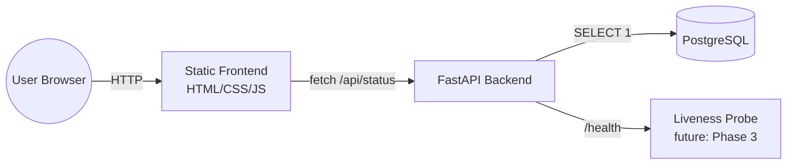

# CloudForge — Production Kubernetes Platform on AWS

> **Status: Phase 1 of 10 complete.** This README grows with each phase; sections
> for Terraform, Kubernetes, CI/CD, GitOps, observability, and security will be
> filled in as those phases land. See [docs/phases.md](docs/phases.md) for the
> full roadmap and phase-by-phase log.

## Project Overview

CloudForge is a portfolio project demonstrating a production-grade DevOps/platform
engineering workflow: containerization, Kubernetes, Infrastructure as Code, CI/CD,
GitOps, observability, and security — all wrapped around a deliberately simple
application. **The application is not the point.** It exists only to give the
platform something real to build, deploy, and operate.

## Technology Stack

| Layer | Technology | Why |
|---|---|---|
| Backend | FastAPI (Python) | Async, minimal, built-in OpenAPI docs, industry-standard for lightweight services |
| Frontend | Static HTML/CSS/JS | No build tooling — keeps focus on infra, not frontend frameworks |
| Database | PostgreSQL | Real stateful dependency to justify RDS, Secrets, and connection management |
| Containers | Docker (multi-stage) | Reproducible builds, small images |
| Orchestration | Kubernetes (EKS) | Industry-standard container orchestration |
| IaC | Terraform | Modular, versioned, reviewable infrastructure |
| CI | GitHub Actions | Test → build → scan (Trivy) → publish to ECR |
| CD | ArgoCD (GitOps) | Declarative, auditable, git-as-source-of-truth deployments |
| Observability | Prometheus, Grafana, Loki | Metrics + dashboards + logs |
| Cloud | AWS (VPC, EKS, ECR, RDS, IAM, ALB, CloudWatch) | Real-world production target |

## Repository Structure

```
cloudforge-platform/
├── app/
│   ├── frontend/        # Static HTML/CSS/JS, calls backend /api/status
│   └── backend/         # FastAPI service, /health and /api/status endpoints
├── terraform/
│   ├── modules/         # vpc, eks, ecr, rds (Phase 5)
│   └── environments/dev # dev environment composition (Phase 5)
├── kubernetes/
│   ├── base/             # Kustomize base manifests (Phase 3)
│   └── overlays/dev/     # dev environment overlay (Phase 3)
├── argocd/                # ArgoCD Application definitions (Phase 7)
├── monitoring/             # Prometheus/Grafana/Loki config (Phase 8)
├── .github/workflows/       # CI pipelines (Phase 4)
├── docs/                     # Architecture notes, runbooks, phase log
└── scripts/                   # Helper scripts
```

## Application Architecture (Phase 1)



- `GET /health` — pure liveness signal, no dependencies. Backing endpoint for
  Kubernetes liveness probes later.
- `GET /api/status` — readiness-style check; reports backend + database
  connectivity. Backing endpoint for Kubernetes readiness probes and what the
  frontend displays.

## Running Locally (Phase 1 — no Docker yet)

**Backend:**
```bash
cd app/backend
python3 -m venv .venv
source .venv/bin/activate
pip install -r requirements-dev.txt
uvicorn app.main:app --reload --port 8000
```

**Frontend:**
```bash
cd app/frontend
python3 -m http.server 3000
```

Open http://localhost:3000 — it will call the backend at `http://localhost:8000`
(configured in `app/frontend/config.js`) and display live backend/database status.

Since PostgreSQL isn't running yet in Phase 1, `database` will correctly show
`disconnected` — this is expected and demonstrates the graceful-degradation
design that will matter once we add real health/readiness probes in Kubernetes.

## Tests

```bash
cd app/backend
pytest -v
```

## Roadmap

See [docs/phases.md](docs/phases.md).

## Security Decisions

- No secrets are ever committed. `.gitignore` blocks `.env`, `*.tfvars`, `*.pem`,
  kubeconfig files, and Terraform state.
- Database credentials are always injected via environment variables /
  Kubernetes Secrets, never hard-coded.
- (More decisions added as each phase introduces new security surface.)
